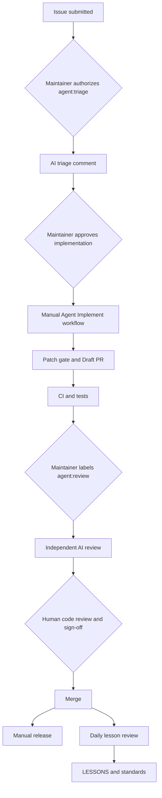

# AgentDevWorkflow Template

A **usable GitHub repository template** for learning and reusing an agent-driven development loop inspired by [Magpie](https://github.com/yetone/magpie).

> 中文：这是一个可实际运行的 AI Agent 软件工程模板，不只是提示词合集。用 **Use this template** 创建新仓库后，可以从 Issue → 分诊 → Codex 编码 → Draft PR → CI → 独立 AI Review → 人工合并 → 手动 Release → 每日复盘，走完整个流程。
>
> **Security by design:** No autonomous merge, no secret-dependent code executed on incoming PRs, no scheduled API spending until you opt in. GitHub Actions AI jobs require your own `OPENAI_API_KEY` secret; a ChatGPT subscription or Magpie account is **not** an API key.

## Lifecycle

## Start here

1. Click **Use this template → Create a new repository**.
2. Read [Setup](docs/SETUP.md), [Architecture/workflow](docs/WORKFLOW.md) and [AGENTS.md](AGENTS.md).
3. Run locally: `python -m unittest discover -s tests -v` and `python scripts/check_template.py`.
4. GitHub → Settings → Secrets and variables → Actions: add **secret** `OPENAI_API_KEY`. Set repository **variable** `AGENT_AUTOMATION_ENABLED=true` when you are ready for label-triggered/scheduled AI actions.
5. Actions → **Bootstrap labels** → Run workflow (once per new repo); or run `bash scripts/bootstrap_labels.sh` with a logged-in `gh`.
6. Open a bug or feature issue. A maintainer adds `agent:triage` to trigger the triage agent; or manually runs **Agent implement** with the Issue number to create a proposed Draft PR.
7. After CI, a maintainer adds `agent:review` to the PR for independent review. Merge only after human review.
8. Run **Release** manually for a tag; **Nightly retrospective** generates a lessons proposal (automatic only if enabled).

**Teaching demo:** [sample app](src/demo_tasks.py), [tests](tests/test_demo_tasks.py), [walkthrough](examples/WALKTHROUGH.md), [sample Issue](examples/BUG_EXAMPLE.md), [sample retrospective](examples/LESSON_EXAMPLE.md).

## What's included

| Layer | Files |
|---|---|
| Agent rules | [AGENTS.md](AGENTS.md), [agents/](agents/) |
| Governance and review | [docs/](docs/) |
| User intake | [Issue templates](.github/ISSUE_TEMPLATE/), [PR template](.github/pull_request_template.md) |
| Executable automation | [Actions](.github/workflows/) |
| Demo and checks | [src/](src/), [tests/](tests/), [scripts/](scripts/) |
| Learning path | [examples/](examples/) |

## Safety model

- **Only maintainers can initiate expensive or write-capable agent runs.** Label triggers additionally require `AGENT_AUTOMATION_ENABLED=true`, and the Codex action independently checks actor write permissions.
- Agent implementation runs with read-only GitHub credentials, a restricted Codex workspace sandbox, and no publish token. A **separate job** validates the generated patch and opens a **Draft PR**, never merges.
- AI review and triage separate read-only model jobs from write-authorized posting jobs.
- Never use `pull_request_target` to execute PR code or give API secrets to untrusted PRs.
- Treat model output as untrusted; review everything even if CI passes. A workflow may propose changes to `docs/`, `src/` and `tests/`; new workflow/security changes require human-created PRs.
- The template does not automatically configure branch protections or required reviews; configure those in your new repo.

## Limitations

- Agent workflows require GitHub-hosted Ubuntu runners and an OpenAI API key with available billing. They are not powered by your Codex subscription.
- AI proposals are best-effort, may be wrong, and are subject to spend and platform limits. Labels or manual dispatch create proposals, **not guarantees** of successful fixes.
- GitHub Actions cannot by itself turn a PR into a merge approval that satisfies human sign-off. CI passing is not a release.
- This is a generic Python demonstration; replace the demo with your own stack and tests when making a new project.

## Attribution

Original educational adaptation inspired by these publicly available Magpie documents: [AGENTS.md](https://github.com/yetone/magpie/blob/main/AGENTS.md), [code-standards.md](https://github.com/yetone/magpie/blob/main/docs/code-standards.md), [LESSONS.md](https://github.com/yetone/magpie/blob/main/LESSONS.md), and [contributors.md](https://github.com/yetone/magpie/blob/main/docs/contributors.md). No proprietary workflow engine or unverified private orchestration code is represented here. License: MIT.
