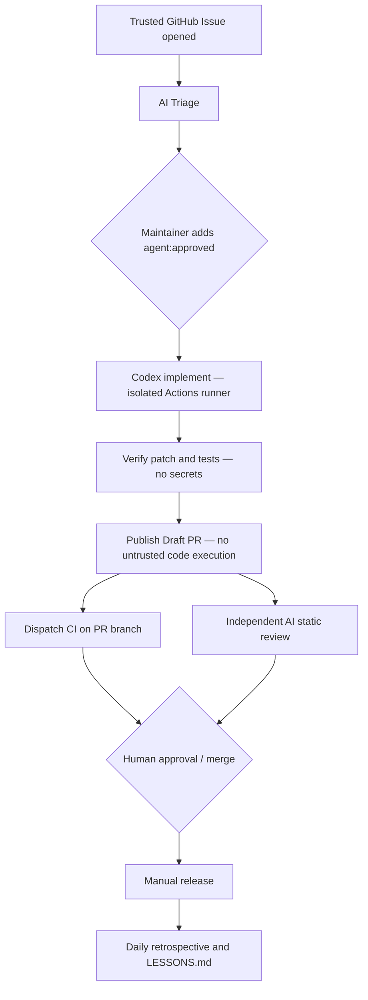

# AgentDevWorkflow Template

> 可复用的 GitHub AI Agent 开发工作流模板，参考 [Magpie](https://github.com/yetone/magpie) 的工程纪律，以 **GitHub Actions 无服务器编排**为默认路线。
>
> **Use this template** 创建新项目，即可套用 Issue 分诊、Agent 编码、隔离验证、Draft PR、独立审查、人工合并、发布与定期复盘流程。默认**不**消耗模型 API 额度。

## Architecture: serverless first

No NAS, VPS, webhook listener, database or always-on agent process is needed for this standard route. GitHub creates an ephemeral runner when a matching event occurs. The [optional Controller](server/README.md) is for teams wanting a persistent SQLite queue, centralized retry budgets and longer-lived scheduling policies.

## Quick start

1. Select **Use this template → Create a new repository**.
2. Run `python -m unittest discover -s tests -v` locally for a no-cost smoke test.
3. Create a dedicated OpenAI API credential and save it as GitHub Actions secret `OPENAI_API_KEY`. Your Codex subscription or Magpie login is not an API key.
4. Set the repository Actions **variable** `AGENT_AUTOMATION_ENABLED=true` when you explicitly want automatic paid model runs. Leave unset for manual-only use.
5. Run **Bootstrap labels** from the Actions tab once.
6. Create a bug or feature Issue. A trusted repository owner's/member's/collaborator's new Issue triggers triage when automation is on; external users require a maintainer-added `agent:triage` label.
7. Review the Issue, then add `agent:approved`. The coding workflow starts automatically and produces a Draft PR if the patch passes verification.
8. The publisher explicitly dispatches deterministic CI for that PR branch. An independent review Agent provides advisory feedback. External fork PRs require a maintainer's manual **Agent review** dispatch, because ordinary fork PR events do not receive API secrets. **A human must still authorize merge and release.**

Detailed instructions: [Setup](docs/SETUP.md) · [Serverless trigger matrix](docs/SERVERLESS.md) · [Architecture](docs/WORKFLOW.md) · [Learning walkthrough](examples/WALKTHROUGH.md).

## What is in the repository?

| Area | Location | Purpose |
|---|---|---|
| Agent entrypoint | [AGENTS.md](AGENTS.md) | Scope, read order, behavioral contract |
| Role prompts | [agents/](agents/) | Triage, coding, review, retrospective, release |
| Standards | [docs/CODE_STANDARDS.md](docs/CODE_STANDARDS.md) | Evidence-driven implementation and testing |
| Security | [docs/REVIEW_POLICY.md](docs/REVIEW_POLICY.md) | Trust boundaries, approvals, dangerous changes |
| Lessons | [docs/LESSONS.md](docs/LESSONS.md) | Review mistakes, promote repeat issues to rules |
| Automation | [.github/workflows/](.github/workflows/) | 7 separate workflows |
| Demo | [src/](src/), [tests/](tests/) | Standard-library Python example and tests |
| Patch gate | [scripts/verify_agent_patch.py](scripts/verify_agent_patch.py) | Reject unsafe paths, symlinks and binary patches |
| Optional service | [server/](server/) | NAS/VPS polling Controller, **not required** |

## Important security boundaries

- All event-triggered AI work requires `AGENT_AUTOMATION_ENABLED=true`. Public strangers opening Issues cannot automatically spend your model budget.
- A maintainer's `agent:approved` label enables coding, not merging.
- The Codex step has read-only repository credentials and a restricted workspace sandbox; the generated patch is verified by a **different job with no API secret**.
- The publishing job can create a Draft PR and dispatch CI, but **does not execute generated code**.
- The AI review reads trusted base code and untrusted PR diff as data; review comments are advisory, not approvals.
- Branch protection, budgets, billing alerts, secrets, repository permissions, and human approval are configured independently in each copied repository. No template can automatically transplant those settings.
- `GITHUB_TOKEN`-generated PR events might not trigger `pull_request` CI. The publisher explicitly invokes `workflow_dispatch` for CI on the new branch.

## Limits

The real paid AI path requires a valid `OPENAI_API_KEY` with billing; passing local tests or CI does **not** prove that a live model invocation succeeded. Default CI validates the example Python project only: adapt it for each derived project's stack. Runner concurrency is handled by Actions per Issue, but global cost budgeting is the responsibility of your OpenAI account or the [optional Controller](server/README.md).

## Acknowledgements

An original educational adaptation of the public engineering practices in Magpie's [AGENTS.md](https://github.com/yetone/magpie/blob/main/AGENTS.md), [code standards](https://github.com/yetone/magpie/blob/main/docs/code-standards.md), [LESSONS.md](https://github.com/yetone/magpie/blob/main/LESSONS.md), and [contributors guide](https://github.com/yetone/magpie/blob/main/docs/contributors.md). This template does **not** claim to reproduce Magpie's private orchestration infrastructure. License: MIT.
